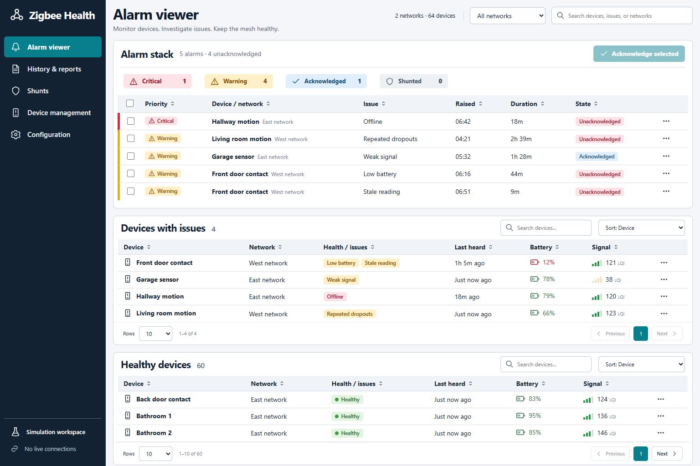

# Zigbee Health

A self-hosted dashboard for device health and area-based Zigbee security across
multiple Zigbee2MQTT networks. Try the isolated simulation without connecting
to a broker.



## Features

- Priority alarm stack, acknowledgement notes and restored-alarm processing.
- Searchable, sortable, paginated issue and healthy-device tables.
- Multiple brokers/base topics, with broker and bridge outage detection.
- Offline, stale, low battery, weak LQI, missing inventory and repeated dropout
  conditions. Global thresholds, device overrides, persistence and hysteresis.
- Timed or indefinite device/category/network shunts. Actual health and history
  remain visible. Expiry rearms a continuing fault once.
- Device reports, battery/LQI charts, event timelines and CSV export.
- Retirement/restoration, confirmed history deletion and links for moved or
  replacement devices.
- SMTP fault/recovery notifications with duplicate suppression and delivery history.
- Installable PWA with browser push, individual browser removal and delivery history.
- Optional MQTT broker connection monitoring and a bounded live topic log.
- Individual user accounts with feature checkboxes, access presets, per-person
  audit attribution and session revocation.
- Light, Dark and System colour themes, remembered in each browser.
- Residential-style security panel with areas, device zones, Home/Away modes,
  entry/exit delays, bypasses, latched alarm memory and weekly schedules.
- Search devices by name, network or Zigbee identity when configuring a zone;
  assign a zone to one or several areas with independent area arming and alarms.
- Optional security MQTT event messages and SMTP alerts, with an independent
  publisher, configurable message templates and recorded delivery results.
- Editable **90-day default retention**. Working alarms, active shunts and current
  configuration survive history cleanup.

Built with React, Vite, Node.js 24, SQLite, MQTT.js and Nodemailer.

## Local use

Install Node.js 24 and pnpm 11.25.0, then:

```sh
pnpm install --frozen-lockfile
pnpm build
pnpm demo
```

Open <http://127.0.0.1:18920>. Simulation contains 64 synthetic devices, keeps
data in `data/simulation`, and cannot enable real broker or email connections.
To reset it, stop the app and remove only that simulation directory.

`pnpm start` opens a separate live workspace in `data/live` with no brokers and
email disabled. Add each network in Configuration, then enable its connection.
New broker entries start disabled. Simulation databases cannot open as live data.
Existing installations keep their database, credential key, brokers and SMTP
settings when upgrading. Back up the data directory first; do not start a blank
volume over an existing installation.

For development, start the backend and run `pnpm dev` in another terminal. Vite
uses port 18921 and proxies the API to port 18920.

## Docker Compose

```sh
cp .env.example .env
# Set a unique ZIGBEE_HEALTH_PASSWORD of 12–128 characters in .env.
docker compose up --build -d
```

Default binding is loopback on port 18920. For trusted LAN access, set
`BIND_ADDRESS` to the host LAN address and `PUBLIC_HOST` to the hostname or IP
used in the browser. Review port and container/volume names before deployment.
Compose uses an unprivileged process, read-only root filesystem, private data
volume and no Docker socket. Use an authenticated HTTPS reverse proxy for remote
access; do not expose the unencrypted administrative interface to the internet.

| Variable | Default | Purpose |
| --- | --- | --- |
| `HOST` | `127.0.0.1` | Native bind address; Compose uses `0.0.0.0` internally |
| `PORT` | `18920` | Native port; Compose uses `8080` internally |
| `DATA_DIR` | `data/live` or `data/simulation` | Database/key directory |
| `PUBLIC_HOST` | empty | Additional permitted browser hostname(s), comma separated |
| `APP_PASSWORD` | empty | Initial `admin` password; required for first setup outside loopback |
| `TZ` | `UTC` | IANA timezone for displayed timestamps, including DST |
| `BIND_ADDRESS` | `127.0.0.1` | Compose host bind address |
| `APP_PORT` | `18920` | Compose published port |
| `ZIGBEE_HEALTH_PASSWORD` | required | Compose initial `admin` password |

## Users, permissions and sign-in

On first account setup, the app creates username **`admin`** with the configured
`APP_PASSWORD` (or Compose's `ZIGBEE_HEALTH_PASSWORD`). When upgrading from the
shared-password version to the account-based releases, use `admin` and the existing dashboard password.
Existing identity-less sessions are signed out during migration. The database,
device history and notification configuration remain in the same data directory.

The environment password seeds the administrator **once**. After accounts exist,
changing that variable does not change an account password or provide an alternate
login. Use **Your account** to change your own password, or an administrator's
**Users** screen to reset another account. Preserve a working administrator login
and protect the data-directory backup.

Administrators add accounts with an individual username, display name, password
and **Allowed features** checkboxes. Choose an **Access preset** as a starting
point, then adjust the feature checkboxes for that person. New accounts start
with the Viewer preset. Usernames are case-insensitive and cannot be renamed;
display names can be changed. Share initial or reset passwords privately. Each
person can change their own password after signing in.

| Access preset | Starting permissions |
| --- | --- |
| Administrator | Every feature plus user administration; full access is fixed |
| Operator | View health and reports; acknowledge/process alarms and manage shunts |
| Viewer | View device health, alarms and reports |

The following checkboxes are independent except where noted. A non-administrator
whose choices differ from the selected preset is shown as **Custom access**.
The user list and account page show the enabled features and their count.

| Feature checkbox | Access granted |
| --- | --- |
| Health monitor | Device health and the alarm stack |
| History & reports | Event history, device trend reports and report export |
| Acknowledge / process alarms | Acknowledge and process alarms; also enables Health monitor |
| Apply / cancel shunts | Apply and cancel shunts; also enables Health monitor |
| Device records & settings | Device lifecycle, record links, rooms and overrides |
| Brokers & live topic log | Broker configuration and the live topic log |
| Thresholds & retention | Global health thresholds and retention settings |
| Email settings | Shared SMTP configuration and delivery history |
| App address & global push | Shared HTTPS address and global push settings |
| View security areas & alarms | Area status, zones, security alarm memory and activity |
| Arm / disarm & bypass zones | Manually operate security areas and bypass zones; also enables Security visibility |
| Security setup & alert actions | Configure protection, automated arm/disarm schedules and alert actions; also enables Security visibility |

User administration belongs only to administrators. It cannot be delegated with
a checkbox; selecting every feature for a non-administrator does not grant it.
Administrator checkboxes are checked and locked. At least one enabled
administrator must remain, so the last one cannot be disabled or demoted.

Everyone can manage their own password and notification preferences, even with no
dashboard features enabled. Receiving alarm push requires **Health monitor**.
Turning that checkbox off also removes acknowledgement/shunt access and disables
the account's existing alarm push subscriptions and pending push messages.
Restoring Health monitor does not restart those subscriptions: the person must
enable notifications again from their browser.

Server-side permission checks apply even if a client manually submits a request.
Alarm acknowledgements, shunts and configuration changes record the acting
username. Accounts are disabled rather than deleted, retaining audit attribution.
Disabling an account ends its sessions, prevents login and stops its browser push
delivery.
Re-enabling an account leaves its old browser subscriptions disabled; that person
can enable notifications again from their browser after signing in.

Administrators can reset passwords and **Sign out everywhere** for a selected
account. A password, access preset or feature-permission change also revokes that
account's existing sessions so the new permissions apply at the next sign-in.
Signing out normally revokes only the current session. Resetting credentials does
not rewrite old audit events or other users' sign-ins.

The login screen offers **Stay signed in for 30 days**, off by default. Without
it, a session lasts up to 12 hours and ends on an app restart. With it, a session
survives restarts for an absolute 30-day period; activity does not extend expiry.
Each session belongs to one enabled user and checks that user's current access.
Account passwords use individually salted password hashes. Only hashes of random
session tokens are stored in SQLite; plaintext passwords and raw session tokens
are not saved there. Cookies are HttpOnly and SameSite=Strict, with Secure on the
configured HTTPS origin. Account and current-access records survive history
retention. Backups include private password hashes and session records.

Cloudflare Access or another authenticated proxy is a separate outer gate. Adding
an app user **does not** add an identity to the proxy's allowlist or grant remote
access through it. Approve and configure any extra proxy identities separately.
Proxy sessions have their own duration and can require a separate login.

### Appearance

Choose **Light**, **Dark** or **System** from the theme control. System follows
the operating system's colour preference. The selected preference is stored in
that browser and applies to the login page, health monitor, reports and dialogs;
changing it does not change another user's browser or the monitoring settings.

The **Health monitor** covers device and broker health. **Security** is a separate
residential-style panel for selected Zigbee devices. New areas start disarmed;
schedules and alert actions start disabled. Administrators have full Security
access. Existing non-administrator accounts keep their current permissions and
receive no Security access automatically. Existing administrator passwords,
stored permissions and remembered sessions are preserved during this upgrade.
See [Security setup and behaviour](docs/security.md).

## Device identity and lifecycle

Records use their network ID and Zigbee IEEE address. A friendly-name change on
the same network preserves history, settings and alarms. Matching names across
networks remain distinct.

- **Retire** stops collection and monitoring, closes working alarms with a retired
  outcome, suppresses queued notifications and cancels device shunts. History
  remains within retention. Rediscovery does not reactivate the device. This
  does not unpair it from Zigbee2MQTT.
- **Restore** resumes monitoring with a fresh baseline. Old battery, signal and
  availability values do not imply health; a new live report is required.
- **Link previous** connects a retired record to its successor. Moved devices
  must share the same IEEE address; replacement hardware has a different address.
  Reports navigate between records while keeping measurements and alarms
  separate. Links can be removed with an audit reason.
- **Delete history** requires retirement, the current device name, the literal
  `DELETE HISTORY` and a reason. This removes the record's samples, incidents,
  delivery records, device shunts and past events from the current database.
  The retired identity, settings, links and a new deletion audit entry remain
  to prevent automatic rediscovery. Existing backups are unchanged.

Inventory disappearance raises a missing-device condition rather than silently
deleting a record. Retired identities and structural links survive pruning.

## Monitoring and email

The collector subscribes to existing Zigbee2MQTT inventory, state, availability
and events. The health collector publishes no queries, controls, scans or MQTT
will. Read-only broker ACLs are sufficient for health monitoring. If you explicitly
enable a Security MQTT alert, its separate publisher also needs permission to
publish to your chosen event topic. Each broker/base-topic entry represents one
network. Security alerts do not publish device commands or bridge requests.

Retained sensor messages do not establish a live baseline. Non-retained receipt
time is not proof of a newly sampled physical measurement. Source outages suspend
device classification instead of declaring every device offline. Signal is
**LQI**, never invented dBm. Tune timeouts for sleepy devices; availability depends
on your existing bridge configuration.

Configure SMTP in Email. Use TLS/STARTTLS for authenticated SMTP. Acknowledgements
and shunts suppress pending fault messages. An accepted alarm can have one
recovery message. “Accepted” means SMTP acceptance, not inbox delivery. Ambiguous
attempts remain uncertain and are never automatically retried.

### Other MQTT brokers and live logs

Choose **MQTT broker & topic log** for a broker without Zigbee2MQTT. This monitors
the MQTT connection and rejected subscriptions; it does not infer individual
service/device health from arbitrary messages. Leave topic filters empty for
connection-only monitoring, or add up to 20 filters, one per line. For example,
`service/available` or `board/+/state`. Zigbee2MQTT remains the default mode.

**Live log** shows the latest 200 received messages per entry, newest first, with
retained flags, filtering and pause. Logs are held only in memory and clear on
restart, disabling or reconfiguration. Previews are limited to 1,000 characters;
large/binary payloads are omitted and common secret fields are redacted. Redaction
cannot recognise every secret: limit topic scope and review before sharing.
No broad wildcard is selected by default for generic brokers.

MQTT connected and Zigbee inventory/bridge state are displayed separately. A
connected broker with no inventory might use a different base topic or have no
Zigbee2MQTT bridge. A network with device history cannot change mode; add another
entry to preserve its history.

## Installable app and browser notifications

Android Chrome is the primary target. Web Push requires a secure HTTPS origin,
a service worker and an explicit permission grant. The LAN HTTP address remains
usable as a dashboard but cannot enrol normal browser push subscriptions.
The signed-in account also needs the **Health monitor** feature to enrol and receive
alarm push. Managing shared app-address/global-push settings requires that
separate feature checkbox or Administrator access.

1. Route an HTTPS hostname through your reverse proxy or Cloudflare Tunnel to
   the existing dashboard HTTP origin. Preserve the public `Host` header. Keep
   app account authentication and any existing access protection enabled.
2. In **Configuration → App & notifications**, save that root HTTPS address
   (for example `https://health.example.test`) and enable push delivery. This
   also permits the hostname at the app. Public-host sessions use Secure cookies.
3. Open that HTTPS address in Android Chrome, sign in, choose **Enable on this
   device**, and allow notifications. Give each browser a recognisable label.
4. Use **Send test** and verify the notification on the named phone. Install via
   Chrome's menu → Add to Home screen → Install, or the in-app Install button
   when Chrome offers it.

The push service receives an encrypted payload; the service worker displays it
without fetching an authenticated API in the background. Tapping it opens the
health monitor, where an expired app/proxy login may require signing in again.
It never acknowledges or shunts an alarm. Proxy access rules must allow the
authenticated browser to register the service worker and load its assets; verify
your actual proxy/phone combination after setup.
The manifest link includes credentials for the signed-in browser, including when
an access proxy protects the manifest. Keep that protection enabled; Android
installation still depends on Chrome and the device's installation policies.

Device names/descriptions are omitted by default for lock-screen privacy. New
subscriptions receive future alarms without replaying the current stack. Fault
and optional recovery notifications follow acknowledgement/shunt rules. The
push service's acceptance does not prove handset delivery. Messages expire after
five minutes; ambiguous outcomes are recorded without automatic retries. Expired
subscriptions are disabled, and can be enabled again from the browser.

Changing the HTTPS app address disables existing subscriptions. Subscriptions
belong to the account that enrolled them; users manage their own browsers and
administrators can manage all browsers. Signing out does not disable push: remove
the browser in notification settings to stop it. Disabling its account also
stops push delivery. Android
permissions, battery restrictions and connectivity affect delivery. Keep SMTP as
a separate fallback where desired. Simulation cannot enrol or send real push.

VAPID signing keys and browser subscription secrets are encrypted using the same
data-directory key as other credentials. Preserve that directory during updates
and backups. No third-party push account or API key is required; the server needs
outbound HTTPS access to the browser's push provider. Supported endpoints include
Chrome/FCM, Firefox, Apple Web Push and Windows push services.

Offline mode displays an explicit connection-unavailable page. Only generic
offline assets are cached; API responses, alarm states and authenticated pages
are never cached by the service worker.

## Storage and backup

SQLite keeps five-minute measurement summaries and individual incident/event
transitions. Cleanup runs hourly. Eligible old history expires under the retention
threshold; working alarms, active shunts and configuration remain independent.
Backup retention is separate.

Broker/SMTP credentials and browser subscription secrets are encrypted with a
separate `secrets.key`; account passwords are stored as salted hashes. Protect the
whole data directory: the database and key together permit credential decryption.
Never commit data, `.env`, backups or real diagnostics.

Create an explicit online backup to a new directory:

```sh
node server/backup.mjs data/live/health.db /private/backups/new-backup
```

It includes the database, matching key and integrity/hash manifest. No schedule
is installed. Restore both `health.db` and `secrets.key` while the app is stopped
and point `DATA_DIR` at that private directory. Keep live/simulation backups separate.

## Development

```sh
pnpm test
pnpm build
```

Tests use synthetic records, loopback brokers and a local SMTP sink. CI also
builds and smoke-tests the container. Real broker and email compatibility depend
on deployment configuration; no production data is included here.

See [CONTRIBUTING.md](CONTRIBUTING.md). Redact addresses, names, credentials and
personal information before sharing issues, logs or screenshots.

## License

[MIT](LICENSE), copyright Zigbee Health contributors. Dependencies retain their
own licenses; see [THIRD-PARTY-NOTICES.md](THIRD-PARTY-NOTICES.md). No code from
other Zigbee dashboards is included.
